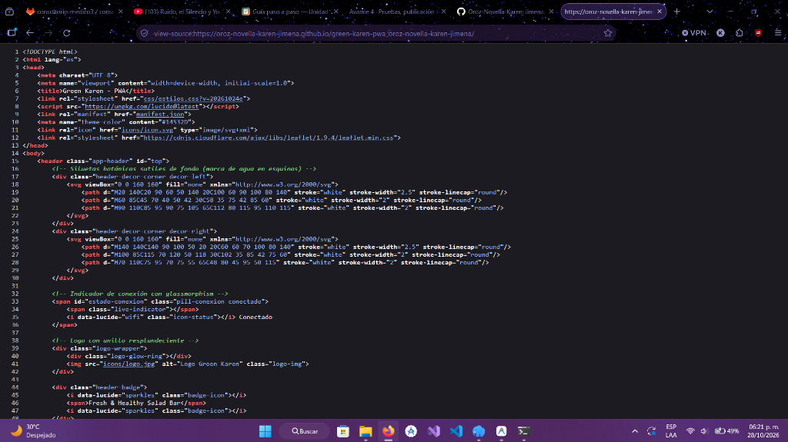
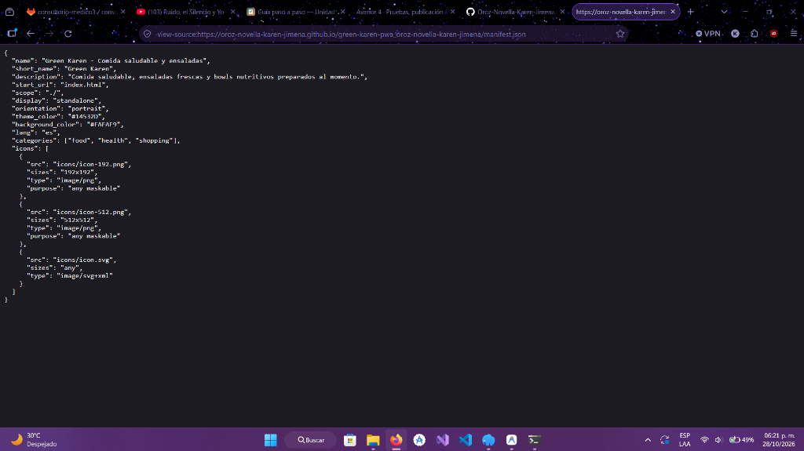
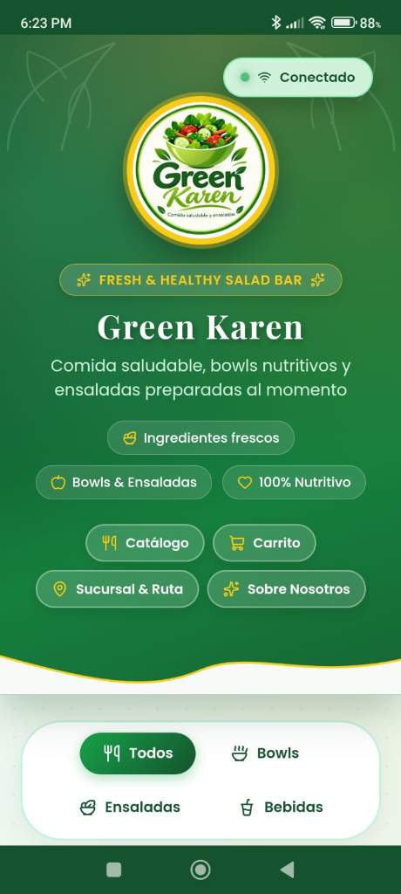

# Green Karen — PWA de ventas

| Dato | Valor |
|---|---|
| **Alumno** | OROZ NOVELLA KAREN JIMENA |
| **Grupo** | ING10-1 |
| **Negocio · giro** | Green Karen · Comida saludable y ensaladas |
| **URL del repositorio** | https://github.com/Oroz-Novella-Karen-Jimena/green-karen-pwa_oroz-novella-karen-jimena |
| **URL de GitHub Pages** | https://oroz-novella-karen-jimena.github.io/green-karen-pwa_oroz-novella-karen-jimena/ |

## Historial de avances

| Avance | Hash del commit entregado | Fecha |
|---|---|---|
| 1 | c7231bf | 11/10/2026 |
| 2 | e2edadb | 18/10/2026 |
| 3 | 54b7554 | 25/10/2026 |
| 4 | (se escribe en el reporte PDF) | 01/11/2026 |

## Comparación SSR vs CSR

### SSR (Django): los productos llegan escritos en el HTML

### CSR (JavaScript): el div del catálogo llega vacío

## Funciones PWA (avance 3)

### Código fuente de index.html: manifest y registro del Service Worker

### Código fuente de sw.js: precache con Workbox

## Versión publicada (avance 4)

### index.html en GitHub Pages

### manifest.json en GitHub Pages

### Mi app instalada en el celular

## Guía de instalación y uso de la PWA

Esta aplicación es una **Progressive Web App (PWA)** que puede instalarse en cualquier dispositivo sin necesidad de tiendas de aplicaciones, funcionando en modo pantalla completa (`standalone`) y con soporte completo sin conexión (offline).

### 1. Instalación en Dispositivos Móviles

#### Android (Google Chrome)
1. Abre el navegador Google Chrome en tu teléfono e ingresa a:  
   `https://oroz-novella-karen-jimena.github.io/green-karen-pwa_oroz-novella-karen-jimena/`
2. Pulsa el botón de menú de tres puntos (**⋮**) ubicado en la esquina superior derecha.
3. Selecciona la opción **"Instalar aplicación"** (o *"Agregar a la pantalla principal"*).
4. Confirma la instalación pulsando **"Instalar"**.
5. La app se agregará a tu pantalla de inicio y cajón de apps con el logo oficial de Green Karen.

#### iOS / iPhone (Safari)
1. Abre el navegador Safari e ingresa a la URL de la aplicación.
2. Pulsa el botón de **Compartir** (ícono de cuadro con flecha hacia arriba) en la barra inferior.
3. Desplázate hacia abajo y selecciona **"Agregar a inicio"**.
4. Pulsa **"Agregar"** en la esquina superior derecha para finalizar.

---

### 2. Instalación en Computadora (Escritorio)

#### Google Chrome o Microsoft Edge (Windows / macOS / Linux)
1. Abre la URL de GitHub Pages en Chrome o Edge.
2. En la barra de direcciones (al lado de la estrella de favoritos), haz clic en el ícono de **"Instalar Green Karen - PWA"**.
3. Pulsa **"Instalar"** en el cuadro de confirmación.
4. La aplicación se abrirá en su propia ventana independiente (sin marco de navegador) y creará un acceso directo en el escritorio.

---

### 3. Guía de Uso de la Aplicación

1. **Apertura en Pantalla Completa:**
   - Abre la app desde el ícono en tu pantalla de inicio o escritorio. Se abrirá en modo `standalone` a pantalla completa.
2. **Exploración del Catálogo y Filtros:**
   - Selecciona los filtros por categoría: **Todos**, **Bowls**, **Ensaladas** y **Bebidas**.
   - Cada platillo incluye su foto, descripción, precio y stock disponible.
3. **Carrito de Compras y Control de Cantidades:**
   - Pulsa *"Agregar al carrito"* en tus productos seleccionados.
   - En la sección del carrito ajusta cantidades con los controles **+** y **-**, con actualización instantánea del monto total.
   - La información se guarda de manera persistente en `localStorage`.
4. **Funcionamiento Sin Conexión (Offline):**
   - El Service Worker precachea los 29 recursos de la tienda. Si no tienes internet, el indicador mostrará *"Sin conexión"* pero el catálogo, fotos y carrito seguirán funcionando.
   - Al volver la red, el carrito se sincroniza automáticamente con el servidor y te notificará en pantalla.
5. **Notificaciones Push:**
   - Pulsa *"Activar notificaciones"* y autoriza los permisos del navegador para recibir alertas de pedidos y estado de conexión.
6. **Geolocalización y Ruta a Sucursal:**
   - Pulsa *"Calcular distancia y ruta"* para obtener tu posición GPS y trazar en el mapa Leaflet la ruta más rápida hacia la sucursal de Green Karen en Plaza Central, Hermosillo.
