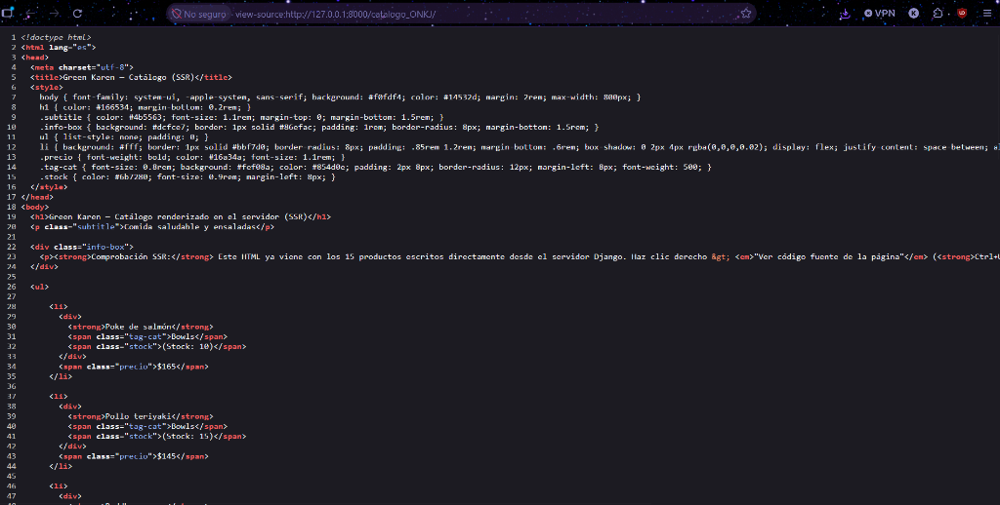
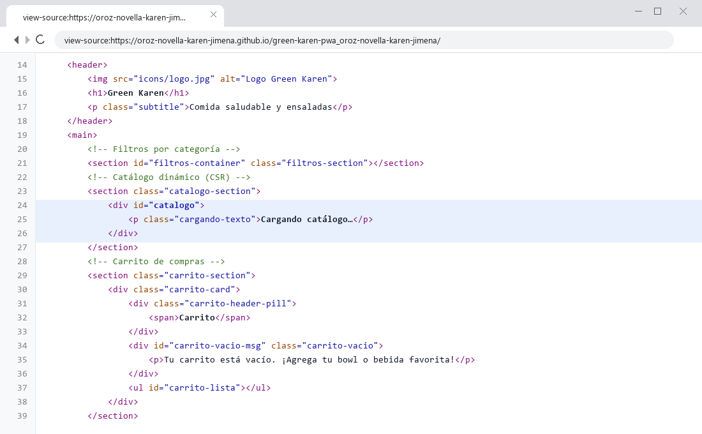
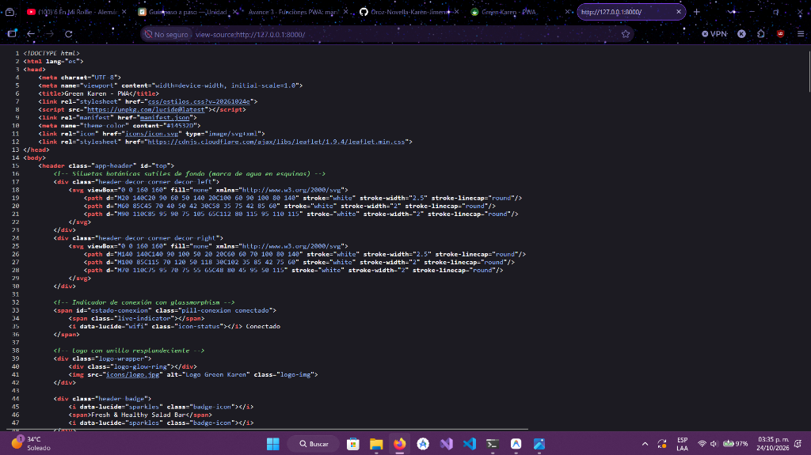
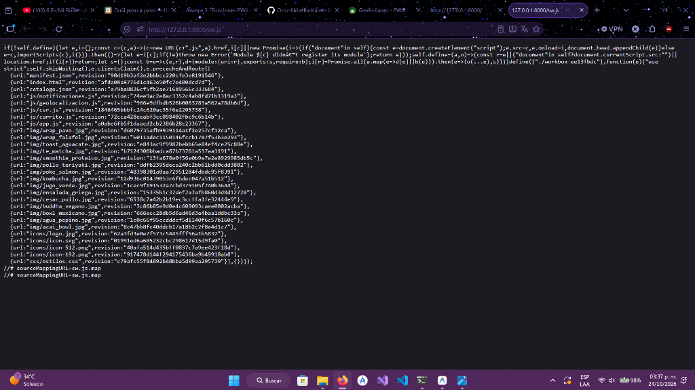

# Green Karen — PWA de ventas

| Dato | Valor |
|---|---|
| **Alumno** | OROZ NOVELLA KAREN JIMENA |
| **Grupo** | ING10-1 |
| **Negocio · giro** | Green Karen · Comida saludable y ensaladas |
| **URL del repositorio** | https://github.com/Oroz-Novella-Karen-Jimena/green-karen-pwa_oroz-novella-karen-jimena |
| **URL de GitHub Pages** | https://oroz-novella-karen-jimena.github.io/green-karen-pwa_oroz-novella-karen-jimena/ |

## Historial de avances

| Avance | Hash del commit entregado | Fecha |
|---|---|---|
| 1 | c7231bf | 11/10/2026 |
| 2 | e2edadb | 18/10/2026 |
| 3 | (hash del avance 3) | 25/10/2026 |
| 4 | (se escribe en el reporte PDF) | 01/11/2026 |

## Comparación SSR vs CSR

### SSR (Django): los productos llegan escritos en el HTML

### CSR (JavaScript): el div del catálogo llega vacío

## Funciones PWA (avance 3)

### Código fuente de index.html: manifest y registro del Service Worker

### Código fuente de sw.js: precache con Workbox

